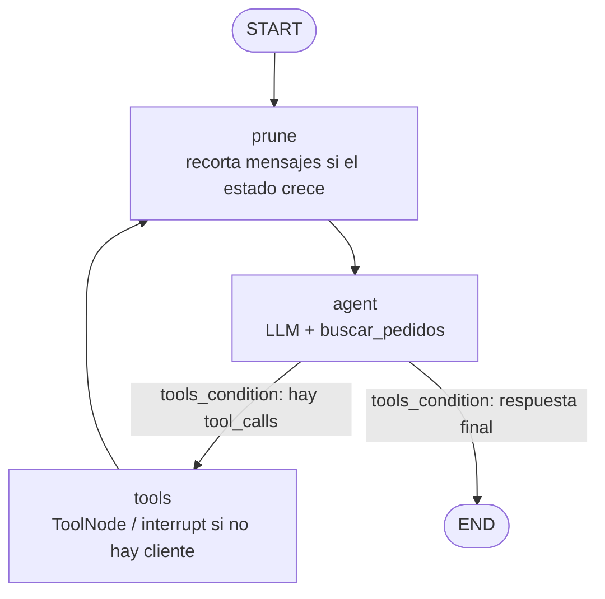

# Preentrega 5 — Agente LangGraph (pedidos)

Agente ReAct asíncrono con LangGraph: consulta pedidos en SQLite, persiste el hilo con `AsyncSqliteSaver` y se detiene para intervención humana si el cliente no existe.

## Requisitos

- Python 3.12+
- `OPENAI_API_KEY` en `.env` (ver `.env.example`)

```bash
python -m venv .venv
source .venv/bin/activate
pip install -r requirements.txt
cp .env.example .env   # completar la API key
python main.py
```

## Flujo



El modelo decide cuándo llamar a `buscar_pedidos`. El enrutamiento lo hace `tools_condition` (sin if/else manual).

## Cómo probar (`python main.py`)

Al iniciar se solicita un `thread_id` (por defecto `demo`). Después se escriben mensajes en la consola.

### 1. Tool + respuesta

`thread_id`: `demo-a`

```
¿Cuántos pedidos tuvo el cliente 102 y cuál fue el total?
```

Resultado esperado: llama a `buscar_pedidos(cliente_id=102)` y responde 3 pedidos / $14.500.

### 2. Memoria con el mismo thread

Continúa en el mismo `thread_id` (`demo-a`):

```
¿y el último?
```

Resultado esperado: responde usando el contexto persistido (pedido #3, $5000, 2024-03-20).

### 3. Human-in-the-loop

Reinicia `main.py` con otro `thread_id`, por ejemplo `demo-b`:

```
¿Cuántos pedidos tuvo el cliente 999 y cuál fue el total?
```

Resultado esperado: se detiene (`interrupt`) y aparece el prompt `cliente_id resume>` → escribe `102` → responde con los datos del cliente 102.

Al salir (Enter vacío) se guarda la traza ReAct en `traces/react.json`.

## Herramienta

`buscar_pedidos(cliente_id: int)` → `{ "cliente_id", "pedidos", "total", "ultimo" }`.

Datos iniciales: el cliente **102** tiene 3 pedidos que suman **14500**.
